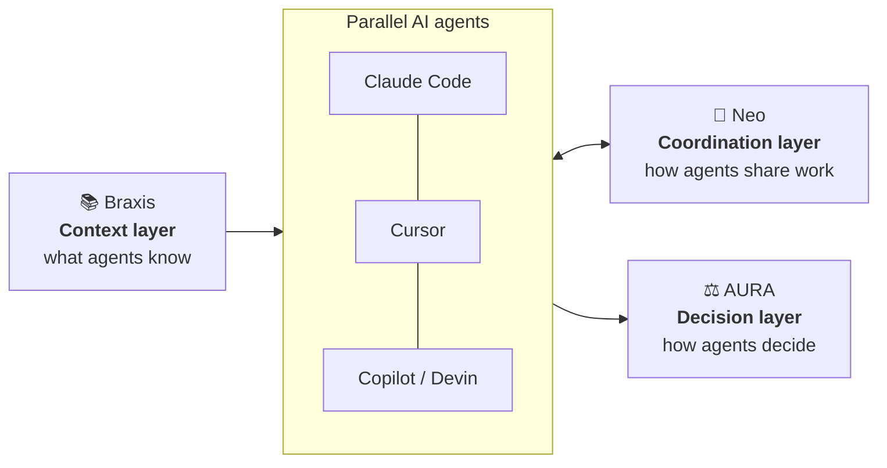

<div align="center">

# Jayakrishna Ichapurapu

### Engineering leader by day · AI systems builder by night

**Building the coordination, context, and decision layers that let teams of AI agents work like teams of people.**

[](https://www.linkedin.com/in/jayakrishnaichapurapu/)
[](https://jolly-heart-a1ca.jaykrishna-i13.workers.dev/)
[](#-primeape94-lab)

</div>

---

## 👋 About me

Twelve years of coordinating large human teams taught me that the hard part is never one smart worker — it's keeping many workers **in sync, informed, and making good collective decisions.** AI agents have exactly the same problem. That's what I build at night.

---

## 🧠 The stack: Neo · Braxis · AURA

Three projects, one thesis: multi-agent systems fail at the seams — agents step on each other, work from stale knowledge, and make decisions nobody can audit. Each project owns one seam.



| Layer | Project | Question it answers |
|---|---|---|
| **Coordination** | [**Neo**](https://github.com/jaykrishna316/Neo) | *Two agents want to edit the same code — who goes, and does the other one know what changed?* |
| **Context** | [**Braxis**](https://github.com/jaykrishna316/braxis) | *Is the project knowledge my agents read still true today?* |
| **Decision** | **AURA** 🔒 | *When agents disagree on a high-stakes call, how do we decide — and prove why?* |

---

### 🔀 Neo — coordination for parallel AI coding agents
[](https://github.com/jaykrishna316/Neo)   

When several Claude Code sessions work in the same repo, they can't see each other. Neo gives them a shared nervous system — it runs as **Claude Code hooks**, so every prompt, read, edit and shell command passes through it.

- **Pre-generation intent checking** — your prompt becomes declared intent, and each edit is rated LOW / MEDIUM / HIGH risk against everyone else's work *before* code is written
- **Region-scoped locks + FIFO queue** — the first editor takes the lock; others queue and are auto-promoted when the holder finishes
- **Staleness detection + delta-only refresh** — the differentiator. If a file changed after an agent last read it, Neo blocks the edit and refreshes only what changed instead of a full re-read. A broad prior-art sweep (GitHub, arXiv, PyPI, npm, HN) found no other coordination tool combining the two
- **Breaking-change & blast-radius gates** — flags changed signatures, lists downstream importers, and blocks edits while a caller is out of sync
- **One-script install** into any repo: `bash scripts/install_neo.sh <your-repo>`

> 🤖 Neo was built almost entirely *by* Claude Code — a coding agent building the coordination layer it needs to work alongside other copies of itself.

**Roadmap:** intent-to-execution verification, multi-generational context lineage, consensus-based conflict resolution, deadlock detection, and a free GitHub App.

---

### 📚 Braxis — the axis of agent knowledge
[](https://github.com/jaykrishna316/braxis) [](https://pypi.org/project/braxis/)  

Agents read `AGENTS.md`, `CLAUDE.md` and `.cursorrules` to understand a codebase — and those files go stale the moment the code moves. Braxis generates them from static analysis and **keeps them in sync on every push**.

```bash
pip install braxis
braxis score      # how agent-ready is this repo? (0–100)
braxis generate   # AGENTS.md · CLAUDE.md · .cursorrules · .agentic-config.json
```

- **Agent-readiness score** across architecture, testing, conventions, security, docs and more — with score history to track improvement
- **Framework detection** in three tiers (fast pattern / AST / deep wrapper analysis), 10+ languages
- **CI-native** — a GitHub Actions workflow regenerates context and opens a PR when your code drifts
- **Zero dependencies**, single-file core; optional Claude-powered recommendations
- Eats its own dog food: Braxis scores itself and the test suite grew out of its own recommendations

**Where it fits:** Neo keeps agents coordinated — Braxis keeps what they know current.

---

### ⚖️ AURA — Council Protocol for auditable multi-agent decisions
   

Most agent frameworks let one model decide, or let agents chat until they agree. **AURA's Council Protocol (ACP)** treats a decision like a well-run governance body: specialized roles — **Memory, Guardian, Learning, Specialist, Shadow, Experimental** — each take a stance, vote in **two phases**, deliberate under a **budget**, and leave an **immutable record of every dissent**.

- **Validated on real public data** — on IBM Telco churn (7,043 customers, independent ground truth), Guardian dissent carried a **19× lift**; on Credit Card Fraud (284,807 transactions), stance-based Guardian lift reached **15.74×**
- **Throughput:** 206K council decisions in ~9 seconds on Instacart-scale data
- **Domain-agnostic kernel** with adapters for customer lifecycle, fraud, healthcare, DevOps/SRE and more — 9 templated domains
- **Cross-model tested** with real LLM calls (Claude Sonnet 4.5, GPT-4o, Qwen, Llama) plus a blind grader
- **Research-grade honesty** — the paper documents its own boundary conditions and negative results (where deliberation *doesn't* help), not just the wins

📄 54-page paper published as a **Zenodo preprint (DOI)**, now in journal review. Companion work in progress: a four-LLM comparison study and spin-off papers on self-auditing ML evaluation, kernel architecture, healthcare and fraud triage.

**Vision — AURA OS:** ACP · AURA Lifecycle · AURA Memory · AURA Search · AURA SDK.

---

## 🧪 More from the lab

### Public
| Project | What it is |
|---|---|
| [**AisleGlyph**](https://github.com/jaykrishna316/Aisleglpyh) | CPU-first framework for retail-specific tokenization — mines domain phrases, builds a reversible prompt codec and a small BPE tokenizer, and reports token savings |
| [**PAAP**](https://github.com/jaykrishna316/PAAP) · [v2](https://github.com/jaykrishna316/PAAPv2-Standalone) | Privacy-Assured Anonymous Participation — blind-issued credentials and scoped nullifiers for eligible-only, one-time actions without identity login |
| **BrowseAI** | Chrome extension for memory-first browsing — session and context history that persists. **Live on the Chrome Web Store** |
| [**GroupBuy**](https://github.com/jaykrishna316/GroupBuy) | Group-discount buying platform |
| [**Snake: Genesis Shift**](https://github.com/jaykrishna316/snake-remastered-genesis-shift) | A remastered take on the classic |

### In the works 🔒
| Project | What it is |
|---|---|
| **AppResilience** | Automated API resilience testing for mobile apps — auto-capture traffic, generate response variants (missing fields, type mismatches, delays, errors), and report pass rates |
| **RetailQuest** | Gamified convenience-retail loyalty concept |
| **Penguins Plunge** | Cross-platform game built with Kotlin Multiplatform |
| **PageHugger** · **TheBeerClub** · **Rules Forge** · **Nova Paint** | Private side projects in active development |

---

## 🛠️ Toolbox


---

## 🦍 Primeape94 Lab

Everything I build ships under **Primeape94 Lab** — my personal signature across apps, sites, repos and AI tools.

<div align="center">

*Leading teams by day. Coordinating agents by night.*

</div>
